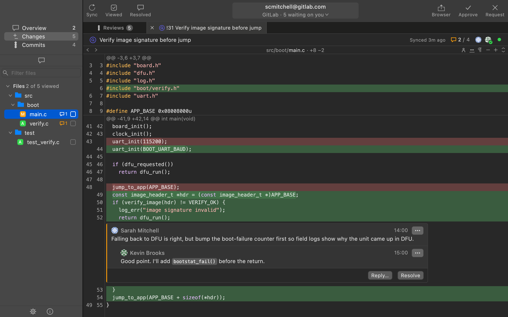

# Iniscape Review

A code review app for macOS, Windows and Linux, built for speed: your
GitHub and GitLab reviews in a native app backed by local cache, enabling
quick operation.

Free, including for commercial use. More info at
[iniscape.com/review](https://iniscape.com/review).

## What it does

- **GitHub and GitLab.** Any number of accounts, self-managed GitLab
  servers included.
- **Threads under their line.** Reply, resolve and suggest; drafts
  publish with your verdict.
- **Files, blame and history.** On any branch, read from a local clone so
  every click stays fast.
- **Whose move it is.** A mark on each review says whether it waits on
  you.
- **Each review in a tab.** Changes, Conversation and Commits over the
  file tree, with viewed boxes.
- **Optional AI drafts.** Off until you pick Claude Code or Codex; you
  edit or drop each draft.

## Install

**macOS and Linux**

    curl -fsSL https://github.com/iniscape/review/releases/latest/download/install.sh | bash

**Windows (PowerShell)**

    powershell -ExecutionPolicy Bypass -c 'irm https://github.com/iniscape/review/releases/latest/download/install.ps1 -OutFile $env:TEMP\install.ps1; & $env:TEMP\install.ps1'

Requirements: macOS 12+ on Apple silicon, Windows 10+ on x64 or
Linux (glibc 2.28+) on x86_64.

It installs for the current user, without admin rights: in
`~/Applications` on macOS, `%LOCALAPPDATA%\Programs` on Windows and
`~/.local` on Linux.

## Uninstall

Uninstalling signs out of every account and deletes the app's data, as
Settings → *Delete All Data…* does: a clone holding local work (changes,
commits or stashes not on the server) is kept, and named.

**macOS and Linux**

    curl -fsSL https://github.com/iniscape/review/releases/latest/download/uninstall.sh | bash

**Windows**: Settings → Apps → Installed apps → Iniscape Review →
Uninstall, or in PowerShell

    powershell -ExecutionPolicy Bypass -c 'irm https://github.com/iniscape/review/releases/latest/download/uninstall.ps1 -OutFile $env:TEMP\uninstall.ps1; & $env:TEMP\uninstall.ps1'

## Notes

- **Signing in** takes a personal access token: the sign-in window says
  which scopes each service needs. Tick *Read only* to have the app send
  nothing to the service.
- **AI** drafts (*AI Review*, *AI Compose* and *AI Rephrase*) are
  optional and off until you pick Claude Code or Codex in Settings → AI;
  the app runs that command-line tool, installed and signed in by you.
- **Windows 11 Smart App Control** may block a new release from starting,
  since the app is not code-signed yet, most often in the first hours
  after the release is out. Try again later.

## Privacy

Iniscape Review does not collect, share or sell any personal data. There
is no Iniscape account, and no built-in analytics, telemetry, crash
reporting or advertising of any kind.

The app talks to the GitHub and GitLab servers of the accounts you add,
with the token you give it, which is kept in your system's credential
store (on Linux, an encrypted file). It shows profile pictures from the
addresses those servers give, Gravatar among them unless you turn that off
in Settings. Once a day it asks github.com whether a newer version is out,
sending only its version, unless you turn that off in Settings. AI drafts,
when you turn them on, go through the tool you picked, to its provider
under your own account.

Everything else the app keeps, its cache of reviews, its settings, its
clones and its log, stays on your computer. The full statement is in the
app: About → *Privacy*.

## Reporting a bug

Open an issue with the
[bug report form](https://github.com/iniscape/review/issues/new/choose).
It asks for the version (shown in About), your OS and the log: About →
*Show Log* shows the file, or find it at:

- macOS: `~/Library/Logs/Iniscape/Review/review.log`
- Windows: `%LOCALAPPDATA%\Iniscape\Review\review.log`
- Linux: `~/.local/state/iniscape-review/review.log`

Feature requests are welcome through the same page. They are read and
noted, then closed, as there is no public backlog. For security issues,
see [SECURITY.md](SECURITY.md).

## Changes

See [CHANGELOG.md](CHANGELOG.md).

## Licence

Copyright (c) 2026 Iniscape. All rights reserved. The Qt libraries that
come with the app are licensed under the LGPLv3; see *Licenses* in the
About dialog, which also lists the other third-party code. The licence
texts come with the app.
